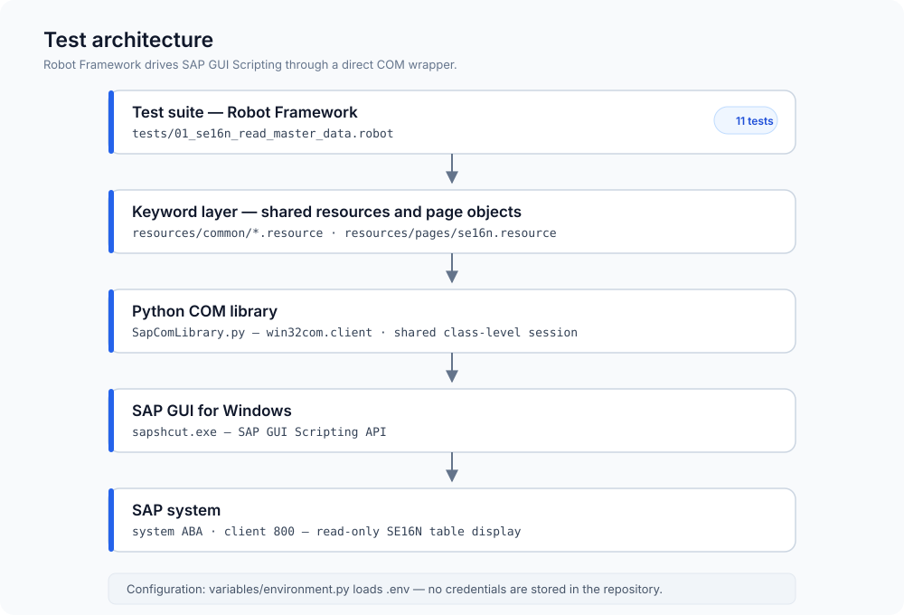
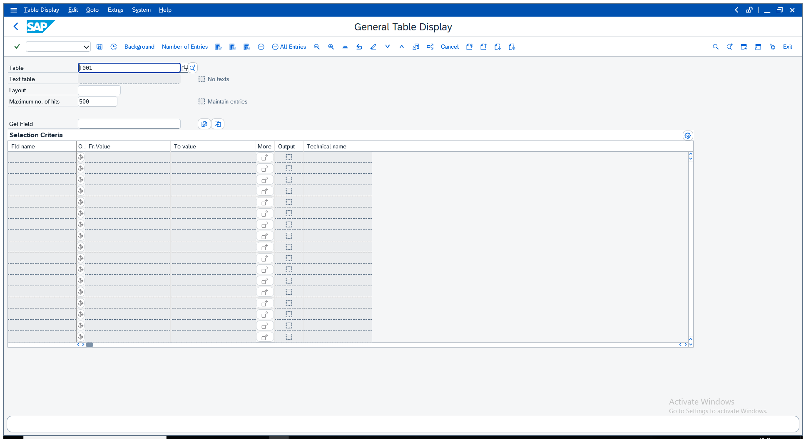
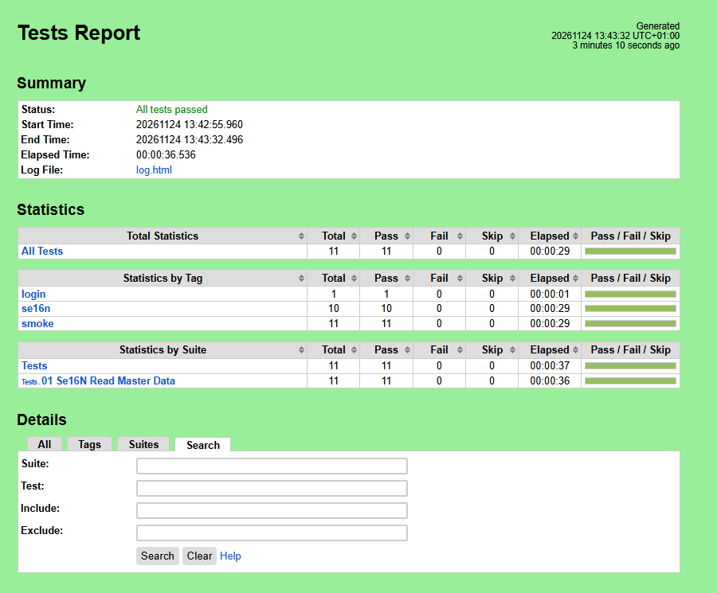
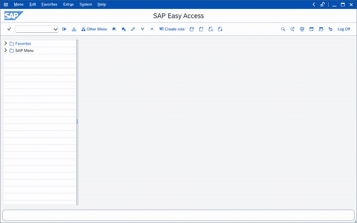
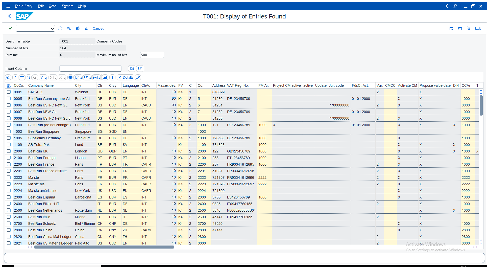

# SAP GUI Robot Framework Test Suite

A small, read-only UI test suite for SAP GUI for Windows. It logs on to an SAP system with
`SAP GUI Scripting`, opens transaction **SE16N** (General Table Display), verifies that
master-data tables return rows, and logs off again. No business documents are created or
changed.

- **Framework:** Robot Framework 7.5.1
- **Automation interface:** SAP GUI Scripting via a direct COM wrapper (`SapComLibrary.py`)
- **Scope:** 11 read-only smoke tests (1 login check + 10 table reads)
- **Platform:** Windows 10, SAP GUI for Windows

---

## Table of contents

- [Architecture](#architecture)
- [Repository layout](#repository-layout)
- [Requirements](#requirements)
- [Environment setup](#environment-setup)
  - [SAP GUI prerequisites](#sap-gui-prerequisites)
  - [Python environment](#python-environment)
  - [Configuration](#configuration)
- [Running the tests](#running-the-tests)
- [Example run](#example-run)
- [Test run video](#test-run-video)
- [Test cases](#test-cases)
- [How a SE16N test works](#how-a-se16n-test-works)
- [Design and conventions](#design-and-conventions)
- [Linting and formatting](#linting-and-formatting)
- [Troubleshooting](#troubleshooting)
- [Limitations and notes](#limitations-and-notes)

---

## Architecture

The test suite is split into a thin business layer (`tests/`), reusable keyword resources
(`resources/`), and a small Python COM library. All SAP GUI element locators live in page
objects, never in `.robot` files.



| Layer | Responsibility |
|---|---|
| `tests/01_se16n_read_master_data.robot` | 11 high-level test cases |
| `resources/common/sap_session.resource` | Start/stop the SAP session, Easy Access helpers |
| `resources/common/statusbar.resource` | Status-bar error assertions |
| `resources/pages/se16n.resource` | SE16N locators and page keywords |
| `variables/environment.py` | Loads connection settings from `.env` |
| `SapComLibrary.py` | COM wrapper for SAP GUI Scripting (`win32com.client`) |

The attached SAP session is stored on the **class** (`SapComLibrary.session`) because Robot
Framework imports the library once per resource file; the class attribute ensures every
resource shares the same session.

---

## Repository layout

```
sap_gui_tests/
├─ tests/
│  └─ 01_se16n_read_master_data.robot
├─ resources/
│  ├─ common/
│  │  ├─ sap_session.resource
│  │  └─ statusbar.resource
│  └─ pages/
│     └─ se16n.resource
├─ variables/
│  └─ environment.py
├─ docs/
│  ├─ images/
│  │  ├─ architecture.svg
│  │  ├─ run-01-easy-access.png
│  │  ├─ run-02-se16n-t001.png
│  │  └─ run-03-report.png
│  └─ video/
│     ├─ test-run.mp4
│     └─ test-run-preview.gif
├─ archive/                    # legacy tests, kept for reference, not executed
├─ SapComLibrary.py
├─ requirements.txt
├─ .env.example
├─ CLAUDE.md
└─ README.md
```

Generated locally and excluded by `.gitignore`: `.env`, `results/`.

---

## Requirements

### Software

| Component | Version tested | Purpose |
|---|---|---|
| Windows | 10 Enterprise | COM / SAP GUI Scripting host |
| Python | 3.15.2 (3.11+ expected to work) | Test runtime |
| Robot Framework | 7.5.1 | Test runner |
| pywin32 | 312 | COM bridge (`win32com.client`) |
| python-dotenv | 1.2.4 | Loads `.env` |
| SAP GUI for Windows | 7.70+ | SAP client |
| SAP GUI Scripting | enabled on client **and** server | Automation API |
| robotframework-robocop | 9.4.0 | Linting (development) |
| robotframework-tidy | 4.18.0 | Formatting (development) |

The suite does **not** use `robotframework-sapguilibrary`; it uses the purpose-built
`SapComLibrary.py` for direct, predictable access to the SAP GUI Scripting COM API.

### SAP authorizations

The automation user must be able to:

- log on to the client interactively (used by `sapshcut.exe`);
- start SE16N and display the tested tables (typically `S_TABU_DIS` / `S_TABU_NAM`).

---

## Environment setup

### SAP GUI prerequisites

1. Install **SAP GUI for Windows** and verify that a manual logon to the target system works.
   The default executable paths used by this project are:
   - `C:\Program Files\SAP\FrontEnd\SAPgui\sapshcut.exe`
   - `C:\Program Files\SAP\FrontEnd\SAPgui\saplogon.exe`

2. **Enable SAP GUI Scripting on the client:**
   SAP Logon → **Options** (or `Alt+F12` in a session) → **Accessibility & Scripting** →
   **Scripting** → enable **Scripting**. The exact menu wording varies slightly by release.

3. **Enable SAP GUI Scripting on the server** (administrator, RZ11):
   - `sapgui/user_scripting = TRUE`
   - optionally review `sapgui/user_scripting_per_user`

   A new session is required after changing the profile parameter. If scripting is disabled
   on the backend, the library reports
   `Scripting not enabled by backend for this session`.

> **Warning:** the suite kills all running `sapshcut.exe`, `sapgui.exe` and `saplogon.exe`
> processes in setup and teardown. Save any unsaved manual SAP work before running the tests.

### Python environment

```powershell
cd C:\Users\<you>\Documents\sap_gui_tests

python -m venv .venv
.\.venv\Scripts\Activate.ps1
python -m pip install --upgrade pip
pip install -r requirements.txt
```

If PowerShell blocks the activation script, allow it for the current shell only:

```powershell
Set-ExecutionPolicy -Scope Process -ExecutionPolicy Bypass
.\.venv\Scripts\Activate.ps1
```

### Configuration

Connection settings are read from environment variables, falling back to the project-level
`.env` file. Real credentials must never be committed.

1. Create your local configuration from the template:

   ```powershell
   Copy-Item .env.example .env
   ```

2. Fill in the values:

   ```dotenv
   # SAP GUI client
   SAPSHCUT_EXE=C:\Program Files\SAP\FrontEnd\SAPgui\sapshcut.exe

   # SAP system connection
   SAP_APP_SERVER=10.0.0.10
   SAP_SYS_ID=ABA
   SAP_SYS_NUM=00
   SAP_CLIENT=800
   SAP_USER=YOUR_SAP_USER
   SAP_PASS=YOUR_SAP_PASSWORD
   SAP_LANG=EN
   ```

3. `.env` is listed in `.gitignore`. OS-level environment variables take precedence over
   values in `.env` (standard `python-dotenv` behavior).

---

## Running the tests

Always run with UTF-8 console settings on this Python/Robot combination (see
[Troubleshooting](#troubleshooting)):

```powershell
$env:PYTHONUTF8 = 1
$env:PYTHONIOENCODING = 'utf-8'

robot --outputdir results tests/
```

The suite opens one SAP session, runs all tests, then logs off and terminates SAP GUI.

### Useful selections

```powershell
# Only the SE16N table tests
robot --include se16n --outputdir results tests/

# Only the login check
robot --include login --outputdir results tests/

# A single test case
robot --test "Read Countries From Table T005" --outputdir results tests/

# Syntax/dry run without touching SAP
robot --dryrun --outputdir results tests/
```

### Output

After a run:

- `results/log.html` — detailed keyword log
- `results/report.html` — summary report
- `results/output.xml` — machine-readable results

---

## Example run

The screenshots below were captured during actual test runs.



*SAP Easy Access right after the automated login.*



*Robot Framework report after a successful run: 11 tests, 11 passed, 0 failed.*

---

## Test run video

The recording below was made during a full 11-test run. Only the SAP GUI window is captured;
no other desktop window appears in the video.

[](docs/video/test-run.mp4)

*The animated GIF is a 2× speed preview. Click it to open the full, real-time recording:
[`docs/video/test-run.mp4`](docs/video/test-run.mp4) (42 seconds).*

---

## Test cases

All tests share the tag `smoke`. The SE16N tests additionally use the tag `se16n`; the login
check uses `login`.

| # | Test case | Table | Data displayed | Example rows* |
|---|---|---|---|---|
| 1 | `SAP Easy Access Is Displayed After Login` | — | Start screen (`/nS000`) | — |
| 2 | `Read Company Codes From Table T001` | T001 | Company Codes | 164 |
| 3 | `Read Clients From Table T000` | T000 | Clients | 4 |
| 4 | `Read Countries From Table T005` | T005 | Countries | 238 |
| 5 | `Read Plants From Table T001W` | T001W | Plants/Branches | 290 |
| 6 | `Read Currency Codes From Table TCURC` | TCURC | Currency Codes | 221 |
| 7 | `Read Units Of Measurement From Table T006` | T006 | Units of Measurement | 436 |
| 8 | `Read Sales Document Types From Table TVAK` | TVAK | Sales Document Types | 375 |
| 9 | `Read Sales Organizations From Table TVKO` | TVKO | Organizational Unit: Sales Organizations | 94 |
| 10 | `Read Distribution Channels From Table TVTW` | TVTW | Organizational Unit: Distribution Channels | 35 |
| 11 | `Read Sales Divisions From Table TSPA` | TSPA | Organizational Unit: Sales Divisions | 50 |

\* Row counts are a snapshot from the reference system and are informational only. The
tests assert **more than zero** rows, not an exact count.

### Detailed test descriptions

Each SE16N test calls the shared keyword `SE16N Table Should Contain Data`. Internally the
keyword (1) opens the table, (2) checks the description and the status bar, (3) executes the
selection, and (4) checks the result title, hit count and grid. The descriptions below list
the table-specific details for each test individually.

---

#### 1. `SAP Easy Access Is Displayed After Login`

| | |
|---|---|
| **Tags** | `smoke`, `login` |
| **Transaction** | `/nS000` |
| **Reference result** | Start screen is shown |

**Purpose:** confirms that the automated logon produced a usable SAP session and that the
SAP Easy Access start screen is reachable.

**What it does:**

1. Navigates to `/nS000` (SAP Easy Access).
2. Dismisses any warning or information popup.
3. Reads the window title.

**Assertions:** the window title contains `SAP Easy Access`.

**Why it matters:** this is the first end-to-end check after the COM attach; it proves that
the session, the scripting interface and the logon are all working before any table is read.

---

#### 2. `Read Company Codes From Table T001`

| | |
|---|---|
| **Tags** | `smoke`, `se16n` |
| **Table** | `T001` |
| **Description** | Company Codes |
| **Key field** | `BUKRS` (company code) |
| **Reference result** | 164 rows |

**Purpose:** reads the FI company-code master data of the client.

**What it does:**

1. Opens `/nSE16N`, enters `T001` and presses Enter.
2. Verifies the table description (`Company Codes`) and that the status bar shows no error.
3. Executes the selection with **F8**.
4. Verifies the result title, the hit count (`> 0`) and the ALV grid row count (`> 0`).

**Data displayed:** company code (`BUKRS`), company name (`BUTXT`), city (`ORT01`), country
(`LAND1`), currency (`WAERS`) and fiscal-year variant (`PERIV`).

**Why it matters:** company codes are the foundation of the financial and sales-organisation
data used by the other tests.

---

#### 3. `Read Clients From Table T000`

| | |
|---|---|
| **Tags** | `smoke`, `se16n` |
| **Table** | `T000` |
| **Description** | Clients |
| **Key field** | `MANDT` (client) |
| **Reference result** | 4 rows |

**Purpose:** reads the client definitions of the system.

**What it does:**

1. Opens `/nSE16N`, enters `T000` and presses Enter.
2. Verifies the table description (`Clients`) and that the status bar shows no error.
3. Executes the selection with **F8**.
4. Verifies the result title, the hit count (`> 0`) and the ALV grid row count (`> 0`).

**Data displayed:** client ID (`MANDT`), client name (`MTEXT`), city (`ORT01`), currency
(`MWAER`), client role (`CCCATEGORY`) and change/protection flags.

**Why it matters:** a small, stable table that confirms the client landscape and the
technical settings of each client.

---

#### 4. `Read Countries From Table T005`

| | |
|---|---|
| **Tags** | `smoke`, `se16n` |
| **Table** | `T005` |
| **Description** | Countries |
| **Key field** | `LAND1` (country key) |
| **Reference result** | 238 rows |

**Purpose:** reads the country master data used by addresses and partner master records.

**What it does:**

1. Opens `/nSE16N`, enters `T005` and presses Enter.
2. Verifies the table description (`Countries`) and that the status bar shows no error.
3. Executes the selection with **F8**.
4. Verifies the result title, the hit count (`> 0`) and the ALV grid row count (`> 0`).

**Data displayed:** country key (`LAND1`), country name (`LANDX`), nationality (`NATIO`) and
ISO code (`LAISO`).

**Why it matters:** country data is referenced by customer, vendor and plant master data.

---

#### 5. `Read Plants From Table T001W`

| | |
|---|---|
| **Tags** | `smoke`, `se16n` |
| **Table** | `T001W` |
| **Description** | Plants/Branches |
| **Key field** | `WERKS` (plant) |
| **Reference result** | 290 rows |

**Purpose:** reads the plant/branch master data.

**What it does:**

1. Opens `/nSE16N`, enters `T001W` and presses Enter.
2. Verifies the table description (`Plants/Branches`) and that the status bar shows no error.
3. Executes the selection with **F8**.
4. Verifies the result title, the hit count (`> 0`) and the ALV grid row count (`> 0`).

**Data displayed:** plant (`WERKS`), name (`NAME1`), city (`ORT01`), country (`LAND1`) and the
assigned sales organisation/distribution channel.

**Why it matters:** plants are the organisational units used for procurement, production and
delivery.

---

#### 6. `Read Currency Codes From Table TCURC`

| | |
|---|---|
| **Tags** | `smoke`, `se16n` |
| **Table** | `TCURC` |
| **Description** | Currency Codes |
| **Key field** | `WAERS` (currency) |
| **Reference result** | 221 rows |

**Purpose:** reads the currency code master data.

**What it does:**

1. Opens `/nSE16N`, enters `TCURC` and presses Enter.
2. Verifies the table description (`Currency Codes`) and that the status bar shows no error.
3. Executes the selection with **F8**.
4. Verifies the result title, the hit count (`> 0`) and the ALV grid row count (`> 0`).

**Data displayed:** currency key (`WAERS`), ISO code (`ISOCD`) and currency attributes.

**Why it matters:** currency codes are required by pricing, conditions and every financial
document.

---

#### 7. `Read Units Of Measurement From Table T006`

| | |
|---|---|
| **Tags** | `smoke`, `se16n` |
| **Table** | `T006` |
| **Description** | Units of Measurement |
| **Key field** | `MSEHI` (unit) |
| **Reference result** | 436 rows |

**Purpose:** reads the unit-of-measure master data.

**What it does:**

1. Opens `/nSE16N`, enters `T006` and presses Enter.
2. Verifies the table description (`Units of Measurement`) and that the status bar shows no
   error.
3. Executes the selection with **F8**.
4. Verifies the result title, the hit count (`> 0`) and the ALV grid row count (`> 0`).

**Data displayed:** unit key (`MSEHI`), dimension (`DIMID`), ISO code (`ISOCODE`) and
conversion factors (numerator/denominator).

**Why it matters:** units are used for all material quantities and order items.

---

#### 8. `Read Sales Document Types From Table TVAK`

| | |
|---|---|
| **Tags** | `smoke`, `se16n` |
| **Table** | `TVAK` |
| **Description** | Sales Document Types |
| **Key field** | `AUART` (sales document type) |
| **Reference result** | 375 rows |

**Purpose:** reads the sales document type configuration.

**What it does:**

1. Opens `/nSE16N`, enters `TVAK` and presses Enter.
2. Verifies the table description (`Sales Document Types`) and that the status bar shows no
   error.
3. Executes the selection with **F8**.
4. Verifies the result title, the hit count (`> 0`) and the ALV grid row count (`> 0`).

**Data displayed:** sales document type (`AUART`) and the delivery/billing type assignments
used by order processing.

**Why it matters:** document types drive the sales-order, delivery and billing flow.

---

#### 9. `Read Sales Organizations From Table TVKO`

| | |
|---|---|
| **Tags** | `smoke`, `se16n` |
| **Table** | `TVKO` |
| **Description** | Organizational Unit: Sales Organizations |
| **Key field** | `VKORG` (sales organisation) |
| **Reference result** | 94 rows |

**Purpose:** reads the sales-organisation configuration.

**What it does:**

1. Opens `/nSE16N`, enters `TVKO` and presses Enter.
2. Verifies the table description (`Organizational Unit: Sales Organizations`) and that the
   status bar shows no error.
3. Executes the selection with **F8**.
4. Verifies the result title, the hit count (`> 0`) and the ALV grid row count (`> 0`).

**Data displayed:** sales organisation (`VKORG`) and its assigned company code.

**Why it matters:** the sales organisation is the highest-level organisational unit in SD.

---

#### 10. `Read Distribution Channels From Table TVTW`

| | |
|---|---|
| **Tags** | `smoke`, `se16n` |
| **Table** | `TVTW` |
| **Description** | Organizational Unit: Distribution Channels |
| **Key field** | `VTWEG` (distribution channel) |
| **Reference result** | 35 rows |

**Purpose:** reads the distribution-channel configuration.

**What it does:**

1. Opens `/nSE16N`, enters `TVTW` and presses Enter.
2. Verifies the table description (`Organizational Unit: Distribution Channels`) and that the
   status bar shows no error.
3. Executes the selection with **F8**.
4. Verifies the result title, the hit count (`> 0`) and the ALV grid row count (`> 0`).

**Data displayed:** distribution channel (`VTWEG`) and its description.

**Why it matters:** the distribution channel defines how products reach the customer (for
example direct sales, wholesale or retail).

---

#### 11. `Read Sales Divisions From Table TSPA`

| | |
|---|---|
| **Tags** | `smoke`, `se16n` |
| **Table** | `TSPA` |
| **Description** | Organizational Unit: Sales Divisions |
| **Key field** | `SPART` (division) |
| **Reference result** | 50 rows |

**Purpose:** reads the sales-division configuration.

**What it does:**

1. Opens `/nSE16N`, enters `TSPA` and presses Enter.
2. Verifies the table description (`Organizational Unit: Sales Divisions`) and that the
   status bar shows no error.
3. Executes the selection with **F8**.
4. Verifies the result title, the hit count (`> 0`) and the ALV grid row count (`> 0`).

**Data displayed:** division (`SPART`) and its description.

**Why it matters:** divisions group products into product lines and are part of the sales-area
key used in sales documents.

> All table tests are read-only: they only display existing rows. The reference row counts are
> a snapshot from the test system; the assertions require only that at least one row is
> returned.

---

## How a SE16N test works



*T001 result screen captured during a test run: 164 company codes returned.*

For every table, `SE16N Table Should Contain Data`:

1. Opens `/nSE16N` and enters the table name.
2. Dismisses any warning popups and asserts the status bar is not an error (`E`).
3. Verifies the table name field and the table description shown by SE16N.
4. Executes the selection with **F8**.
5. Verifies that the result-screen title contains the table name.
6. Reads the **Number of hits** field and asserts it is greater than zero.
7. Reads the ALV result grid row count and asserts it is greater than zero.

If a step fails, Robot Framework reports the failing keyword and the SAP element or value in
the log.

---

## Design and conventions

- **English identifiers and comments** everywhere.
- **Locators are centralized:** SAP GUI IDs (`wnd[0]/...`) appear only in `.resource` files,
  never in `.robot` tests.
- **Explicit synchronization:** tests do not use `Sleep`; they assert SAP status-bar state
  and screen elements instead.
- **Status-bar verification:** `Statusbar Should Not Report Error` fails on message type
  `E` and is called after navigation and execution.
- **Robust startup:** `Open SAP Session` retries the `sapshcut.exe` launch + COM attach once
  (`Wait Until Keyword Succeeds`), which covers occasional slow SAP GUI startup.
- **No credentials in the repository:** `variables/environment.py` reads `.env`, which is
  gitignored.
- **4-space indentation** and `robotidy` formatting.

---

## Linting and formatting

```powershell
# Lint (Robocop 9 uses the "check" subcommand)
robocop check tests resources

# Format
robotidy tests resources
```

Both commands must finish without findings before committing changes.

---

## Troubleshooting

| Symptom | Likely cause | Resolution |
|---|---|---|
| `Could not attach to SAP GUI session ... MK_E_SYNTAX` | SAP GUI is not running/registered in COM, startup was slow, or scripting is disabled | Verify a manual logon works; enable scripting; run again (the setup retries once); increase `timeout` in `Open SAP Session` if the client is very slow |
| `Scripting not enabled by backend for this session` | RZ11 `sapgui/user_scripting` is `FALSE` | Set it to `TRUE`, open a new SAP session |
| Status bar type `E` on a table | Missing authorization or invalid table | Check `S_TABU_DIS` / `S_TABU_NAM`; use a permitted table |
| `utf-8:surrogateescape` / encoding crash in the console | Python 3.15 + Robot 7.5.1 console encoding | Set `PYTHONUTF8=1` and `PYTHONIOENCODING=utf-8` |
| Open SAP windows disappear | The suite kills all SAP GUI processes in setup/teardown | Save unsaved work before running |
| `robocop tests/ resources/` → `No such command` | Robocop 9 uses subcommands | Use `robocop check tests resources` |
| `Grid Row Count` fails after an SAP UI change | ALV grid path changed | Update `${SE16N_RESULT_GRID}` in `resources/pages/se16n.resource` |
| Number of hits is exactly 500 | SE16N default maximum hits (`GD-MAX_LINES = 500`) | Expected for large tables; the tests only require more than zero hits |

---

## Limitations and notes

- **Read-only by design.** The suite only displays table contents; it does not create,
  change, or delete business data.
- The tests depend on the **result-screen title**, the **Number of hits** field, and the
  **ALV grid** provided by SE16N. A different SAP release or a customized SE16N layout may
  require locator updates in `resources/pages/se16n.resource`.
- The legacy sales-order test is kept in `archive/` but is **not executed**. Creating a
  VA01 order in the reference system fails with a backend ABAP `SYNTAX_ERROR`
  (`SAPLV61A` / `RV63A630`), so the active suite was intentionally made read-only.
- The suite is Windows-only because it relies on `win32com` and SAP GUI for Windows.
